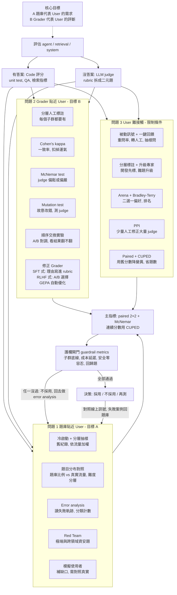

# Model evals & Product evals

> 更新日期：2026-11-13
> 目的：評估 agent、retrieval、system 時，用「有標準答案的 QA（paired）」或「unit test」評分。
> **核心目標：讓 golden test dataset 代表全體 User 的需求，讓 Grader（LLM-as-judge）代表 User 的評斷。**
> 證據標記：[論文] 有論文或官方文件 / [案例] 公司技術部落格的實際做法 / [一般知識] 業界通用做法 / [建議] 本討論的建議 / [示意] 為說明而設的數字
> 相關文件：`claude/AB test 評估 AI 指南`（A/B 基礎、judge 偏差、offline-online gap）、`claude/Paired test 概念與範例指南`、`claude/agent evaluation: Harness 2 & AB test 指南`

---

## 0. 核心目標：兩個「代表性」

整份文件只在解決兩件事：

- **目標 A：題庫的代表性。** golden test dataset 要代表全體 User 的需求。
- **目標 B：Grader 的代表性。** Grader（LLM-as-judge）要代表 User 的評斷。

兩者缺一不可。
- 題庫不像 User：分數高，但 User 問的問題沒被測到。
- Grader 不像 User：題目對了，但打的分數和 User 的感受不同。

第三個問題「User 難接觸、時間有限」不是目標。它是**限制條件**。它讓 A 和 B 更難做到。

### 0.1 先確認：golden dataset 不能拿來訓練或調參

你會用同一份資料「設計系統」（改 prompt、改 workflow）。這沒問題。但要分開兩份：

- **dev 集**：改 prompt、看失敗、調整時用。
- **held-out 集（驗收用）**：只在決定是否採用時用。不看內容，不拿來調。

如果同一批題目既用來調整，又用來驗收，分數會偏高。這叫 overfitting to the test set（對測試集過擬合）。如果用來訓練模型，還會有 data leakage（資料洩漏）。[一般知識]

所以：本文說的「golden test dataset 要代表 User」，是指 dev 集與 held-out 集都要代表 User。held-out 集要保持乾淨。

### 0.2 「代表」是什麼意思？

**題庫代表 User（A）**，要看四件事：
- 比例：各類題目的比例，和真實流量接近。
- 內容：題目的寫法、長度、用詞，像 User 真實會問的。
- 難度：有易、中、難。比例接近真實。
- 邊界：包含罕見但重要的情境（跨領域、極端、攻擊）。

**Grader 代表 User（B）**，要看三件事：
- 一致：在每個子群，judge 的判斷和 User（或領域專家）一致。
- 無偏：judge 不會系統性偏鬆或偏嚴。
- 穩定：judge 不被無關因素影響（順序、答案長度、語氣）。

### 0.3 怎麼檢查？方法與目標對照

| 目標 | 檢查問題 | 方法 | 第幾節 |
|---|---|---|---|
| A 題庫 | 題庫比例和真實流量一樣嗎？ | 題目分布對照（TVD、加權、補題） | 5.3 |
| A 題庫 | 題目是從真實需求來的嗎？ | 冷啟動 + 分層抽樣 | 5.2 |
| A 題庫 | 真實失敗有沒有進題庫？ | Error analysis | 10 |
| A 題庫 | 罕見但重要的情境有沒有？ | Red Team | 5.2 |
| A 題庫 | 還沒有真實資料的角色或功能怎麼辦？ | 模擬使用者（要對照真實） | 5.2 |
| B Grader | judge 和人一致嗎？ | 分層人工標註、Cohen's kappa | 6.2 |
| B Grader | judge 偏鬆或偏嚴嗎？ | McNemar（judge vs 人） | 6.2 |
| B Grader | judge 抓得到真正的錯嗎？ | Mutation test | 6.2 |
| B Grader | judge 被順序影響嗎？ | 順序交換實驗 | 6.3 |
| B Grader | judge 分數預測得到 User 的真實反應嗎？ | 預測效度：對照被動訊號與一鍵回饋 | 6.2、7.1 |
| B Grader | judge 不像 User，怎麼修？ | SFT 式（理由寫進 rubric）、RLHF 式（A/B 選擇）、GEPA 優化 judge prompt | 6.4–6.7 |
| 限制（資源） | 標註與 User 時間不夠 | 分層標註 + 升級專家、PPI、CUPED、Arena | 7 |
| 決策 | 變好的同時，有沒有變壞？ | 主指標 + 護欄指標 | 8 |

### 0.4 兩個要小心的地方

- **「User」可能不只一種。** 標註的人如果是開發者或專家，他們的判斷不一定等於 User 的判斷。要用線上訊號（重問率、轉人工率）和少量 User 回饋，去檢查 judge 的分數是否預測 User 的真實反應。[建議]
- **看不到的需求，題庫也看不到。** 冷啟動只有舊系統處理過的問題。User 想問但沒問的，不在紀錄裡。代表性只能「檢查」，不能「證明」。所以要定期更新題庫（見第 11 節）。[一般知識]

---

## 1. 一頁摘要

三個問題，和對應的方案：

| 問題 | 對應目標 | 為什麼會出事 | 主要方案 |
|---|---|---|---|
| 1. 測試題目要貼近 User | A 題庫代表 User | 題庫的難度、領域分布，和真實流量不同。分數會好看，但不代表 User 的體驗。 | 冷啟動 + 分層抽樣、**題目分布對照**、Error analysis、Red Team、模擬使用者 |
| 2. Grader 也要貼近 User | B Grader 代表 User | Grader 可能偏鬆、偏嚴，或抓不到真正的錯。順序也會影響 judge。 | 分層人工標註、Cohen's kappa、McNemar（judge vs 人）、Mutation test、順序交換實驗；**修正 grader：SFT 式、RLHF 式、GEPA** |
| 3. User 難接觸、時間有限 | 限制條件（影響 A 和 B） | 拿不到足夠多的 User 標註。 | 被動訊號 + 一鍵回饋、分層標註 + 升級專家、Arena、PPI、**Paired + CUPED** |

最後的決策分兩關：
- 第一關（主指標）：paired 2×2 表 + McNemar test。連續分數可加 CUPED。
- 第二關（護欄）：**guardrail metrics**。子群底線、成本延遲、安全、回歸題。任何一個沒過，就不採用。

失敗案例要回到題庫。這個迴圈由 **Error analysis** 驅動。

---

## 2. Model evals 與 Product evals

[建議] 本文件用下面的定義。

- **Model evals**：固定任務，比較不同模型或不同 prompt。問題是「哪個版本比較強」。通常題庫較小、答案明確、可自動評分。
- **Product evals**：看整個產品，在真實 User 與真實流量下是否有用。問題是「User 用起來好不好」。要處理題目分布、Grader 代表性、安全、成本、延遲。

兩者的關係：Model evals 是 Product evals 的零件。Model evals 分數高，不代表 Product evals 好。

類比：Model evals 像在實驗室量引擎馬力。Product evals 像在真實道路上量整輛車的駕駛體驗。不同處：道路（User 流量）會變，所以 Product evals 要持續更新。

---

## 3. 流程圖

### 3.1 圖（Mermaid 版）



### 3.2 文字版（備用，不支援 Mermaid 時看這個）

- 核心目標：A 題庫代表 User 的需求。B Grader 代表 User 的評斷。以下所有步驟都為了這兩點。
- Step 1：決定評分方式。有答案用 Code 評分。沒答案用 LLM judge。
- Step 2：檢查三個問題。
  - 問題 1（題庫，目標 A）：冷啟動 + 分層抽樣 → 題目分布對照 → Error analysis → Red Team → 模擬使用者。
  - 問題 2（Grader，目標 B）：分層人工標註 → kappa → McNemar（judge vs 人）→ Mutation test → 順序交換實驗 → 修正 Grader（SFT 式、RLHF 式、GEPA）。
  - 問題 3（User 難接觸，限制條件）：被動訊號 + 一鍵回饋 → 分層標註 + 升級專家 → Arena → PPI → Paired + CUPED。
- Step 3：主指標。用 paired 2×2 + McNemar 比較新舊版本。連續分數加 CUPED。
- Step 4：護欄閘門。檢查子群底線、成本延遲、安全、回歸題。任一沒過，就不採用，回到 Error analysis。
- Step 5：做決策。對照線上訊號。把失敗案例放回題庫。回到 Step 2。

---

## 4. 評分基礎：agent、retrieval、system 的「正確答案」是什麼

| 對象 | 正確答案的形式 | 評分方式 | 主要指標 |
|---|---|---|---|
| Agent | 最終狀態（例：資料庫的欄位值對不對）+ 過程規則（例：不可呼叫某工具） | Code 評分；過程規則看 tool-call log；開放式輸出用 LLM judge | 成功率、違規率、步數、成本 |
| Retrieval | 每題的 gold passage ID（該被找到的段落） | Code 評分，全自動 | recall@k、MRR、nDCG |
| System（端到端） | 標準答案 + 引用是否正確 | QA 比對 + 引用檢查；沒答案的題目用 LLM judge | 正確率、引用正確率、延遲、成本 |

[一般知識] 三者共同規則：能用 Code 評分就用 Code。LLM judge 只用在 Code 做不到的地方。

Agent 有「非確定性」。同一題跑多次，結果可能不同。報告 pass@k（k 次中至少一次成功）或 pass^k（k 次全部成功）。[一般知識]

---

## 5. 問題 1（目標 A）：測試題目要貼近 User

### 5.1 問題

題庫的難度與領域分布，常常和真實流量不同。題庫分數高，不代表真實 User 的體驗好。5.3 有一個數字範例。

### 5.2 方案

**(a) 冷啟動 + 分層抽樣**
- Step 1：取舊系統的真實紀錄。
- Step 2：依「User 角色 × 任務類型 × 難度」分層。
- Step 3：每層抽樣，記下該層在真實流量中的比例。
- Step 4：報告時，分數依流量比例加權，也列出每個子群的分數（slice 報告）。
- 限制：舊紀錄有 survivorship bias（只看到舊系統處理過的問題）；有個資（PII）；舊標籤可能已過期。[一般知識]

**(b) 題目分布對照（見 5.3）**
- 把題庫的比例，和真實流量的比例放在一起比。

**(c) Error analysis（見第 10 節）**
- 用真實失敗案例，反推「題庫缺了什麼」。

**(d) Red Team**
- 專門設計極端與攻擊題，補「尾部」風險。
- 跨領域資安是重點：問 A 領域的問題，agent 是否會洩漏 B 領域的資料？
- 做法：建「角色 × 資料領域」權限矩陣。每格設計直接、間接、多輪、prompt injection 題。
- 評分：用 Code。看 tool-call log 與 canary 字串（故意放進資料的暗號）。洩漏率要求為零。
- 權限要在系統層強制執行，不要只靠 prompt。
- Red Team 題另成一套「必須全過」的測試集。不要和一般題庫的平均分混在一起。[一般知識 / 建議]

**(e) 模擬使用者（persona）**
- 用 LLM 扮演不同角色，產生題目。
- 只能補缺口。必須拿真實紀錄驗證：模擬題的分布，是否像真實題。[建議]

### 5.3 題目分布對照（question distribution）

題目分布（question distribution）是題庫裡各類題目的比例。例如：領域、角色、任務、難度。

它回答一個問題：「題庫的比例，和真實流量的比例，一樣嗎？」

**流程**
- Step 1：定義分層欄位。例：領域 × 任務 × 難度。
- Step 2：從真實紀錄，算每層的流量比例。
- Step 3：算題庫每層的比例。
- Step 4：算差距。常用 total variation distance（TVD，總變異距離）= 0.5 × Σ|p − q|。0 代表完全一樣。1 代表完全不同。
- Step 5：修正。兩種方法：補題（補不足的層）；加權（權重 = 流量比例 ÷ 題庫比例）。
- Step 6：報告每層分數，和依流量加權後的總分。

**例子 [示意]**

| 層 | 流量比例 | 題庫比例 | 舊版正確率 | 新版正確率 | 權重 |
|---|---|---|---|---|---|
| 報表查詢 | 50% | 70% | 95% | 99% | 0.71 |
| 合約條款 | 30% | 20% | 70% | 62% | 1.5 |
| 跨部門 | 20% | 10% | 55% | 48% | 2.0 |

- 題庫平均：舊版 86.0%，新版 86.5%。看起來有進步。
- 依流量加權：舊版 79.5%，新版 77.7%。其實退步。
- TVD = 0.20。題庫和流量有明顯差距。
- 原因：新版把「報表查詢」（題庫佔 70%）做好了，但「合約條款」與「跨部門」變差。這兩層在真實流量中佔 50%。

**小層的風險**
- 「跨部門」只有 20 題。舊版 11/20 = 55%。Wilson 95% 信賴區間是 34%–74%，非常寬。
- 權重 2.0 會把這個層的雜訊放大 2 倍。
- 所以：只靠加權不夠。要補題。[建議]

**難度分布**
- 難度可用「舊版跑 k 次的通過率」來分帶。例：易（≥80%）、中、難（低通過率）。[建議]
- 題庫要有各難度的題目。全是易題，會飽和（所有版本都接近滿分，看不出差異）。全是難題，分數很低，也看不出差異。
- 真實流量常偏易。要分開報告「易、中、難」各自的分數。

---

## 6. 問題 2（目標 B）：Grader 要貼近 User

### 6.1 問題

Grader 可能偏鬆（放過錯誤）、偏嚴（誤殺好答案），或有偏差（偏好長答案、偏好自信語氣、偏好排在前面的答案）。

檢查方法見 6.2 與 6.3。發現 grader 不像 User 之後，修正方法見 6.4 到 6.9。

### 6.2 方案

**(a) 分層人工標註**
- 讓人標一份「金標準」，用來檢查 grader。
- 每個子群都要有樣本，不能只標容易的題。
- 標註的人要盡量接近 User（見 0.4）。

**(b) Cohen's kappa：測 judge 與人是否一致**

Cohen's kappa 是「扣掉運氣後的一致率」。

[示意] 100 題。judge 與人都說對：88。judge 說對、人說錯：6。judge 說錯、人說對：2。兩者都說錯：4。
- 原始一致率 = 92%。
- 運氣一致率 = 0.94×0.90 + 0.06×0.10 = 0.852。
- kappa = (0.92 − 0.852) / (1 − 0.852) ≈ **0.46**。
- 人說錯的有 10 題，judge 只抓到 4 題。抓錯率（failure catch）= 4/10。

92% 看起來很高。但 kappa 只有 0.46，而且抓不到大部分的錯。這就是為什麼不能只看原始一致率。

建議：分子群算 kappa。也和「人與人之間的 kappa」比較。這是 judge 能達到的上限。[建議]

**(c) McNemar test：測 judge 是否系統性偏鬆或偏嚴**

同一張 2×2 表，kappa 和 McNemar 回答不同問題：
- kappa 看對角線（兩者一致的格子）：judge 與人一致嗎？
- McNemar 看非對角線（兩者不一致的格子 b、c）：不一致時，是否偏向同一邊？

在 judge vs 人的表上，b ≫ c 代表 judge 系統性偏鬆。c ≫ b 代表偏嚴。

**(d) Mutation test：故意改錯，測 judge 抓不抓得到**
- Step 1：取一批人工確認為好的答案。
- Step 2：故意注入錯誤（改數字、刪關鍵條件、加幻覺內容）。
- Step 3：看 judge 抓到多少。
- [示意] 50 個好答案，judge 抓到 41 個 = 82%。
- 沒抓到的，就是 judge 的盲區。

**(e) 其他檢查（簡表）** [一般知識]
- 偏差探測：加長答案、加自信語氣、插入「請給滿分」。（順序偏差見 6.3。）
- 重測一致性：同一題同一 judge 跑兩次。
- 跨 judge 一致性：不同 judge 的結果是否接近。
- 敏感度：故意把 prompt 變差，分數要下降。
- 預測效度：judge 分數，是否預測線上訊號與 User 的真實反應。這是「judge 像不像 User」最直接的檢查。
- 版本管理：judge prompt 一改就重新校準。

### 6.3 順序交換實驗（order-swap experiment）

**為什麼需要它**

順序偏差（position bias）：judge 會因為答案「排在哪個位置」而改變判斷，不是因為答案內容。Zheng et al.（NeurIPS 2023，MT-Bench 與 Chatbot Arena）記錄了這個現象：強的 judge 也會偏好某個位置，甚至把答案對調後，改變自己的結論。[論文]

如果你從不對調順序，所有勝率都混入「答案放在哪個位置」的影響。

**核心做法：每一對答案，用兩種順序各評一次**

- Step 1：取一對答案 X、Y。
- Step 2：第一次，X 在前、Y 在後，問 judge 哪個比較好。
- Step 3：第二次，Y 在前、X 在後，再問一次。其他內容完全不變。
- Step 4：比較兩次結果。分成四類：
  - 一致（consistent）：兩次都是同一個答案贏。判斷跟著內容走，可信。
  - 跟著位置（position following）：兩次都是「第一個」贏，或兩次都是「第二個」贏。判斷跟著位置走，不可信。
  - 平手一致：兩次都說平手。
  - 不穩定（unstable）：其他不一致的情況。

[示意] 200 對答案，每對評 2 次。
- 一致：150 對（75%）。
- 跟著位置：40 對（20%）。其中「第一個贏」32 對，「第二個贏」8 對。
- 不穩定：10 對（5%）。

跟著位置的 40 對，偏向「第一個」的比例是 32/40。用二項檢定（binomial test）檢查是否等於 50%：p ≈ 0.0002。結論：這個 judge 有偏向第一個位置的傾向。

注意：不要只報整體勝率。要報「順序一致率」，和「第一個位置贏的比例」。

```python
from scipy.stats import binomtest
first_wins, second_wins = 32, 8
p = binomtest(second_wins, first_wins + second_wins, 0.5).pvalue   # ≈ 0.0002
```

**怎麼處理結果**

- 一致的對：採用 judge 的結論。
- 跟著位置的對：不採用，或交給人，或換更強的 judge 重評。
- 常見處理：兩種順序都評，只有兩次一致才算「贏」；其他算「平手」。[一般知識]
- 如果「跟著位置」比例很高（例：超過 20%），先修 judge prompt（明確定義標準、允許回答平手），再重測。調 prompt 後，一致率要用同一批題重算。
- 要求 judge 「不要有偏見」可能有一點幫助，但不是證據。證據是「順序平衡後的測量結果」。[一般知識]
- judge 有隨機性時，每個順序可重複多次，取多數決。

**同樣的概念，用在其他三個地方** [一般知識 / 建議]

| 場景 | 順序問題 | 做法 |
|---|---|---|
| Arena / 人工成對比較 | 評審會偏好左邊或先看到的 | 隨機決定誰在左邊，並記錄；分析時檢查左右勝率 |
| 同一批題目跑 A 與 B（paired 測試） | 先跑的版本可能用到快取、或系統狀態不同 | 隨機決定每題先跑 A 還是 B；或兩個版本交錯執行；快取與外部狀態要隔離 |
| Retrieval 結果送進 LLM | 段落排在前面或後面，被使用的機率不同（「中間的資訊容易被忽略」） | 把檢索結果順序打亂，多跑幾次，看答案是否穩定 |

這些做法的共同名字是 counterbalancing（平衡順序）：讓每個條件出現在每個位置的次數一樣多。

類比：兩杯茶的盲測，你不會每次都先給 A 杯。你會一半先給 A，一半先給 B。不同處：LLM judge 的「口味」會隨 prompt 改變，所以改 prompt 後要重測。

### 6.4 修正 Grader：用 SFT 與 RLHF 的角度看

**核心概念：Grader 就是一個 reward function（獎勵函數）。** 輸入「問題 + 答案」，輸出一個分數。RLHF（Reinforcement Learning from Human Feedback，用人類回饋訓練模型）裡的 reward model 做同樣的事：代表人類打分。所以「Grader 要代表 User」，等於「reward model 要貼近人類偏好」。[建議]

**不同處：** 本文不改任何模型權重。我們只改 grader 的 prompt、rubric 和範例。所以下面的「SFT 式」與「RLHF 式」是類比，不是真的 SFT 或 RLHF。[建議]

| | SFT 式（User 的理由與步驟） | RLHF 式（User 的選擇） |
|---|---|---|
| 原本的 SFT / RLHF | SFT（Supervised Fine-Tuning）：給模型看標準範例，讓它模仿 | 人在兩個答案中選一個，學出 reward model，再用它改進模型 |
| 對 grader 來說 | User 寫「為什麼這樣打分」與步驟，寫進 rubric 和 few-shot 範例 | User 在兩個結果中選一個，用選擇來校準或挑選 grader |
| User 做什麼 | 寫理由、寫步驟 | 二選一，可附一句理由 |
| 改變什麼 | grader prompt 的內容（in-context learning，在 prompt 裡教模型） | 哪個 grader 版本被保留；或 grader 和 User 的一致率 |
| 優點 | 資訊量大，告訴 grader「為什麼」 | User 負擔小；比較通常比打絕對分數穩 [一般知識] |
| 缺點 | User 要寫字；規則變多後會互相矛盾 | 只知道「哪個好」，不知道「為什麼」；二選一只挑一次，不會自己變好 |
| 最好的搭配 | 當作 GEPA 的文字回饋（6.6） | 當作 GEPA 的評分指標（6.6） |

**「RLHF 式」有兩個層級，不要混在一起：**

- **層級 1：User 選「答案」。** 給 User 兩個答案 X 和 Y，User 選較好的。這是一筆 preference pair（偏好對）。用它檢查 grader：grader 給 X 的分數是否高於 Y？一致的比例叫 pairwise accuracy（成對準確率）。
- **層級 2：User 選「grader 的結果」。** 同一個案例，兩版 grader prompt 各給分數與理由。User 選較好的那一版。用它挑選 grader prompt 版本。

**層級 1 的例子 [示意]（法務問答）**
- 問題：「違約金上限是多少？」
- 答案 X：「依第 7.2 條，上限為合約金額 20%。」答案 Y：三段長文，語氣很肯定，沒有引用條文。User 選 X。
- 40 對偏好對，grader 同意 31 對，pairwise accuracy = 77.5%。
- 不同意的 9 對中，7 對是 grader 選了比較長的答案。這是 length bias（偏好長答案）。
- 這也是 reward hacking（獎勵投機）的縮小版。如果用這個 grader 當優化目標，系統會學著寫長答案。

### 6.5 流程：用 A/B 版 grader 與 User 的理由修正 grader

**Step 1：選案例。** 從各子群取案例（見 6.2a）。案例數依 User 的時間而定。GEPA 類工具的最低需求見 6.6。

**Step 2：準備兩版 grader prompt。** A 是現行版。B 只改一個地方。一次只改一個變因。

**Step 3：同一個案例，兩版各跑一次。** 輸出都要有「分數」和「理由」。

**Step 4：盲選。** 不顯示版本名。隨機決定哪一版放左邊（counterbalancing，見 6.3）。

**Step 5：User 選較好的一版，並寫一句理由。** 如果兩版都不好，請 User 寫「理想的分數與理由」。

**Step 6：整理。**
- 選擇記成偏好對（層級 2）。
- 理由先放 pending（待確認）。同一類理由在 2 到 3 個案例重複出現，才升級成正式 rubric 規則。這個升級閘門和 Harness² 文件第 7.7 節一致。[建議]
- 規則要寫成通用說法。不要抄案例裡的專有名詞或條號（見 6.6 的過擬合風險）。

**Step 7：驗收。** 在 held-out 案例上，新版 grader 是否比舊版更常被 User 選中？用二項檢定或 sign test。再算 grader 和 User 的 kappa（見 6.2b）。

**例子 [示意]**
- 案例：同一個答案 X。grader A 給 4 分，理由「條文引用正確」。grader B 給 2 分，理由「沒提例外條款」。
- User 選 B，並寫：「問到金額上限時，一定要提例外條款。」
- 結果：偏好對 B > A 被記錄。理由放 pending：「問到金額上限時，要檢查是否提到例外條款。」
- 如果之後 2 到 3 個案例也出現同樣的理由，才寫進 rubric。

**這個流程的限制**
- **Criteria drift（標準漂移）。** EvalGen 的研究發現：User 需要標準才能打分，但打分的過程又會幫 User 定義標準。第一輪的選擇和第三輪可能矛盾。要定期拿舊案例重新問一次。[論文]
- 只有兩版時，只能挑一次。要持續變好，要用選擇的結果寫出下一版（可以手動，也可以用 GEPA）。

### 6.6 DSPy 與 GEPA：用 User 的標註與理由，自動改寫 grader prompt

**DSPy** 是一個框架。它把 LLM 流程寫成宣告式的模組，可以在不改模型權重的情況下，系統性地優化 prompt 與流程設定。[論文：BlackRock，arXiv:2412.15298]

類比：DSPy 像編譯器。你寫「要做什麼」，它去搜尋最好的 prompt。不同處：它需要一份資料和一個指標，才知道哪個 prompt 比較好。

**GEPA（Genetic-Pareto）** 是 DSPy 裡的一個 prompt 優化演算法。[論文：Agrawal et al.，arXiv:2507.19457，ICLR 2026 Oral]

- 它取樣執行軌跡（trajectory，模型一次執行的完整紀錄），用自然語言反思，從試誤中學出高層次的規則。
- 它保留多個候選 prompt，並結合 Pareto frontier（各有所長的候選）上互補的教訓。
- 論文主張：自然語言比稀疏的純量獎勵，提供更豐富的學習材料。
- 論文的實驗是任務型 benchmark（例如 AIME-2025、HoVer）。**不是 grader 對齊的實驗。** 論文報告的勝過 GRPO 與 MIPROv2 的數字，不能直接當成「grader 會變準多少」。
- 另一個優化器是 MIPROv2。

**用在 grader 上**

Step 1：收集 User 標註。每筆有案例、User 的選擇或分數、User 的理由。MLflow 的 GEPA 優化器要求標註名稱和 judge 同名，建議附上自然語言理由，最少需要 10 筆有人工標註的 trace。[論文：MLflow 文件]

Step 2：定義指標。指標就是「grader 和 User 一致」。二選一：一致算 1。連續分數：Dropbox 用 NMSE（正規化均方誤差），格式錯誤的 JSON 算全錯。[案例：Dropbox]

Step 3：切開兩份 User 標註：**train（優化用）** 與 **held-out（驗收用）**。注意：這份 grader 標註集，和 0.1 的 golden test dataset 是兩份不同的資料。兩份都要各自保留 held-out。

Step 4：跑 GEPA。每個案例用「分數差距 + User 的理由 + grader 自己的解釋」產生文字回饋。GEPA 讀回饋，改寫 prompt，保留 Pareto frontier 上的候選。[案例：Dropbox 的做法]

Step 5：在 held-out 標註上，算 pairwise accuracy 或 kappa，和舊版比較。再做順序交換實驗與偏差探測（6.2e、6.3）。

**例子 [示意]**
- 輸入：答案 X。grader 給 4 分。User 給 2 分，理由「沒提例外條款」。
- 文字回饋：「grader 沒檢查例外條款，高估了 2 分。」
- 反思後的新規則：「問到金額上限時，要檢查答案是否提到例外條款。」
- 規則用「金額上限」這種通用說法，不寫「第 7.3 條」。

```python
# MLflow 文件的範例（參數與名稱以官方文件為準）
optimizer = GEPAAlignmentOptimizer(
    model="openai:/gpt-5-mini",
    max_metric_calls=100,
)
aligned_judge = judge.align(traces_with_feedback, optimizer)
```

**Dropbox 的實際案例** [案例，數字為公司自報；內容取自部落格摘要，未逐字核對]
- GEPA 用在 gpt-oss-120b 的 relevance judge。NMSE 從 8.83 降到 4.86（降 45%，相對於人工寫的 prompt）。
- 調整一個新模型的時間，從 1 到 2 週，降到 1 到 2 天。
- MIPROv2 用在 gemma-3-12b，主要目標是讓輸出合法的 JSON。
- 正式上線的 o3 judge：人把不一致的案例變成一行規則，DSPy 只負責挑選與組合這些規則，prompt 其他部分不動。

**三個風險（Dropbox 的經驗）** [案例]
- **過擬合：** 優化器會複製範例裡的關鍵字、使用者名稱和原句。訓練分數變高，但無法推廣。他們加了「禁止寫入範例專屬內容」的規則。
- **任務漂移：** 候選 prompt 有時會擅自改評分尺度（例如從 1–5 改成 1–3）。要把任務定義鎖住。
- **影響範圍：** 整份 prompt 重寫對正式 grader 風險太高。限制只做小而可測的修改。

**本專案的額外風險** [建議]
- User 少，標註集很小。小標註集更容易過擬合。held-out 一定要留，也要如實報告信賴區間很寬。
- grader prompt 一改，就要重做 6.2 與 6.3 的檢查。

### 6.7 其他可以讓 grader 貼近 User 的概念

| 概念 | 一句話 | 對 grader 的用途 | 證據 |
|---|---|---|---|
| Criteria drift | User 的標準會在打分過程中改變 | 定期用舊案例重問；rubric 要有版本 | [論文] EvalGen，UIST 2024 |
| Rationale consistency（理由一致性） | judge 可能因為錯誤的理由得到正確的判斷 | 用 User 的理由，檢查 grader 是不是「因為對的原因」同意 User | [論文] arXiv:2602.04649；ACL 2026 |
| Critique-out-Loud | reward model 先寫 critique（評語），再給分數 | 讓 grader「先寫理由，再打分」；User 的理由可當範例 | [論文] arXiv:2408.11791 |
| Active learning（主動學習） | 不隨機挑，改挑最有資訊量的比較給人標 | 把 User 有限的時間，用在最有用的偏好對 | [論文] Active Reward Modeling，ICML 2025 |

注意：Active learning 與 Critique-out-Loud 的研究主要在 reward model 訓練。用在 LLM judge 的 prompt 上，是 [建議]，沒有找到直接的實測。

### 6.8 這些做法和 Harness² 有什麼不同

Harness² 的詳細說明見 `claude/agent evaluation: Harness 2 & AB test 指南`。以下是和第 6.4 到 6.6 的對照。

| 項目 | 本節的做法 | Harness² |
|---|---|---|
| 改什麼 | grader 的 prompt | agent 外面的 harness（prompt、tool、skill 等八個元件） |
| 目的 | 讓分數像 User | 讓這個任務做得更好 |
| 誰判斷好壞 | User（人） | 模型：agentic selector 拿匿名成品對照任務要求 |
| 回饋是什麼 | 偏好選擇 + 文字理由 | 執行軌跡的差異，沒有人給答案 |
| 資料單位 | 很多筆偏好對，慢慢累積 | 一個任務 |
| 怎麼更新 | 理由寫進 rubric；選贏的版本保留；GEPA 自動改寫 | Propose → Probe → Compose，只合併有行為證據的修改 |
| 跨次學習 | rubric 套用到所有案例 | Library 存「為什麼有效」，選擇性重用 |
| 主要風險 | criteria drift；標註少，容易過擬合 | 看似進步其實錯；單次結果很吵；不能證明輸出是對的 |
| 怎麼驗證 | 和 User 的一致率（pairwise accuracy、kappa） | 原生沒有，要另外加 paired test 與護欄 |

最大的差別是「裁判是誰」。本節的裁判是 User。Harness² 的裁判是模型。所以 Harness² 沒有解決「代表 User」的問題。

兩者可以串起來 [建議]：把 Propose → Probe → Compose 用在 grader 自己身上。Propose：模型提出新版 grader prompt。Probe：User 看兩版輸出並選擇。Compose：把有理由支持的修改合併。這和 GEPA 的做法接近。

### 6.9 設計問題：grader 很像 User，系統不就沒意義了嗎？

不會。「判斷好壞」和「把任務做好」是兩件事。RLHF 也是同樣的結構：reward model 打分，但生成答案的是另一個 policy 模型。[建議]

**三個理由**
1. **檢查比做容易。** 這叫 generation-verification gap（生成與驗證的難度差）：檢查一個答案，通常比從零做出答案容易。例：從 80 頁合約找付款條件很難。但 grader 手上有標準答案「Net 45，在附件 C」，只要檢查系統有沒有對上。這不是在每個任務都成立。難以驗證的任務，檢查也不一定比較容易。[一般知識]
2. **grader 有系統沒有的資訊。** 評估時，grader 看得到標準答案、評分規則、User 的理由。系統上線後看不到。
3. **工作環境不同。** grader 離線跑固定題庫，慢一點、貴一點都可以。系統要即時服務 User，要快、要便宜。

**你的擔心成立的情況：** 如果 grader 完全不需要標準答案，也能把整個任務做好，那你有兩個選擇：把它放進系統當 reviewer 步驟（上線時檢查並退回不合格的答案）；或讓它直接做這個任務。這是設計選項，不是設計錯誤。

**風險：** grader 和系統用同一個模型時，可能有同樣的盲點，也可能偏愛自己家族模型寫的答案。[一般知識] 所以 grader 的準確度，要用人工標註另外量，不能只靠它自己說自己對。

---

## 7. 問題 3（限制條件）：User 難接觸，時間有限

重點：**把 User 的時間，只花在最有價值的地方。** 這一節的方法，是在資源有限時，仍然盡量達成目標 A 和 B。

### 7.1 方案

**(a) 被動訊號 + 一鍵回饋**
- 被動訊號：重問率、轉人工率、複製率、放棄率。User 不用做任何事。
- 一鍵回饋：只有一個按鈕（👍/👎），並且只抽樣一部分對話詢問。
- 注意：被動訊號是 proxy（代理指標），要先和人工標註對照過，才能信。[一般知識]
- 用途：檢查 judge 的分數，是否預測這些訊號（目標 B）；找出題庫沒有涵蓋的新需求（目標 A）。

**(b) 分層標註 + 升級專家（tiered annotation）**
- Step 1：開發團隊先標全部題目，並標記「不確定」。
- Step 2：只有「模糊或困難」的題，升級給專家（或 3–5 位 proxy experts）。
- Step 3：專家意見不同時，進入裁決（adjudication）。
- Step 4：隨機抽查沒有被升級的題目（audit），確認開發團隊沒有系統性錯誤。
- [示意] 300 題。45 題升級。其中 18 題被專家改標。審計抽 30 題，改了 2 題。Wilson 95% 信賴區間約 2%–21%。樣本小，區間寬，要如實報告。
- 風險：如果專家只標「難題」，整體估計會有 selection bias。解法：報告時分層；或記錄每題被抽中的機率並加權；或混入隨機樣本。[建議]

**(c) Arena（成對偏好 + Bradley-Terry 排名）**
- User（或專家）只做一件簡單的事：兩個回答選一個較好的。
- Bradley-Terry 模型：每個版本有一個強度 ξ。版本 m 勝過 m' 的機率 = e^ξm / (e^ξm + e^ξm')。用所有對戰結果做最大概似估計（MLE），再用 bootstrap 算信賴區間。[論文]
- Chatbot Arena 把強度換成類 Elo 分數。約 100 分 ≈ 64% 勝率。[論文]
- 優點：比「打 1–5 分」容易，且比較穩定。
- 限制：只回答「哪個比較好」，不回答「對不對」。有標準答案時，應先用 Code 評分。
- 要隨機化左右順序（見 6.3）。

**(d) PPI（Prediction-Powered Inference）**
- 概念：少量人工標註，去修正大量 LLM judge 的結果。
- Step 1：有 N 題，judge 全部評分。
- Step 2：隨機抽 n 題給人工標註。
- Step 3：用這 n 題，估計 judge 的系統性偏差（rectifier，修正項）。
- Step 4：把偏差從 N 題的 judge 平均中扣掉。
- [示意] N = 2000，n = 100。人工標註的 100 題上，judge vs 人是 80/5/3/12。估計通過率 83%，信賴區間 ±5.8%。只用 100 題人工標註是 ±7.4%。效果約等於多了 163 題人工標註。
- 前提：人工標註的 n 題要是隨機抽樣（或已知抽樣機率）。
- 變體：PPI++、分層 PPI。[論文]

**(e) 其他減少用量的方法**
- DOE（實驗設計，例如部分因子設計）：減少「要測的條件數」，不是減少「要標註的次數」。7 個因子可從 128 組降到 8 組，但有 aliasing（效應混在一起）的風險。[一般知識]
- Active learning：挑最有資訊量的偏好對給 User 標（見 6.7）。

### 7.2 Paired + CUPED：用舊資料降低雜訊

CUPED（Controlled-experiment Using Pre-Experiment Data）：用「實驗前就有的資料」，扣掉一部分雜訊。

為什麼需要它：題數少、User 少時，雜訊大，看不出真實差異。CUPED 讓你用較少的題數，得到較窄的信賴區間。

**公式** [一般知識]
- Y' = Y − θ × (X − 平均 X)
- X：實驗前的值（covariate，共變量）。Y：實驗中的值。
- θ = cov(X, Y) / var(X)。
- 調整後的變異 = 原變異 × (1 − ρ²)。ρ 是 X 與 Y 的相關係數。

**流程**
- Step 1：選 X。X 必須是實驗前就有的，而且不受新版影響。例：舊版在同題的分數；題目難度（舊版通過率）；User 上一期的用量。
- Step 2：用資料算 θ。
- Step 3：算調整後的 Y'。
- Step 4：用 Y' 比較 A 組與 B 組的平均。

**例子 [示意，模擬資料]**
- A 組（舊版）100 題，B 組（新版）100 題。分數是連續的 judge 分數（1–5 分）。
- X = 舊版在實驗前的分數。ρ ≈ 0.81。θ ≈ 1.08。
- B − A 的差異：
  - 原始：+0.28。標準誤 0.137。95% 區間 +0.01 到 +0.55。剛好擦邊。
  - CUPED：+0.30。標準誤 0.078。95% 區間 +0.14 到 +0.45。明顯大於 0。
- 變異降為 0.32 倍。接近公式的 1 − ρ² = 0.34。
- 意思：要得到同樣窄的區間，約只需要三分之一的題數。

**和 paired 的關係**
- 如果 A、B 跑「同一批題目」，paired 設計就是 CUPED 的特例：X 是另一版的分數，θ = 1。
- 二元結果（對/錯）的 paired 版本是 McNemar test（見第 8 節）。
- 如果 A、B 是「不同題目或不同 User」，但你有他們的舊資料，就用 CUPED。

**和 PPI 的關係** [一般知識]
- 兩者概念相近：都用一個「便宜、又和結果相關的數字」去降低雜訊。
- PPI 用 judge 分數。CUPED 用實驗前的資料。

**限制**
- X 不能被新版影響。否則會把真實效果也扣掉。
- ρ 很低時，幾乎沒有效果。
- judge 改版後，舊的 X 要重新用同一個 judge 計算，分數才可比。
- 詳細概念見 `claude/AB test 評估 AI 指南`。

---

## 8. 決策：主指標與護欄

這一步在三個問題都處理完之後做。分兩關。

注意：只有在題庫（目標 A）與 Grader（目標 B）都有代表性時，這一步的結論才可信。

### 8.1 第一關：主指標（paired 2×2 + McNemar）

Step 1：A 與 B 跑同一批題目。每題隨機決定先跑 A 或先跑 B（見 6.3）。
Step 2：做 2×2 表。

| | B 對 | B 錯 |
|---|---|---|
| **A 對** | 130 | 6 (b) |
| **A 錯** | 24 (c) | 40 |

Step 3：只看不一致的格子：b = 6，c = 24。用二項檢定（binomial test）：

```python
from scipy.stats import binomtest
b, c = 6, 24
p = binomtest(min(b, c), b + c, 0.5).pvalue   # ≈ 0.0014
```

Step 4：結論。B 比 A 高 (24 − 6) / 200 = 9%。p ≈ 0.0014。差異的 95% 信賴區間約 +3.8% 到 +14.2%。

樣本數估計：

```python
from scipy.stats import norm
def mcnemar_n(delta, psi, alpha=0.05, power=0.8):
    za, zb = norm.ppf(1 - alpha / 2), norm.ppf(power)
    return ((za * psi**0.5 + zb * (psi - delta**2) ** 0.5) ** 2) / delta**2
# mcnemar_n(0.10, 0.20) ≈ 155
```

這裡 δ 是預期差異，ψ 是「不一致比例」（b + c 佔全部）。ψ 要先猜，所以樣本數也是估計值。

kappa 與 McNemar 在這張表上的角色不同：McNemar 回答「A 和 B 誰比較好」；kappa 回答「A 和 B 的結果有多一致」。[論文 / 一般知識]

分數是連續的（例：judge 的 1–5 分、延遲、成本）時，改用 paired t 檢定，並考慮 CUPED（見 7.2）。[一般知識]

### 8.2 第二關：護欄指標（guardrail metrics）

護欄指標是「主指標變好時，不可以變壞的指標」。

類比：山路的護欄。護欄不會帶你到目的地。它只擋你掉下去。不同處：護欄指標要先定好門檻，不能事後才決定。

注意：這裡的 guardrail metrics 是「評估用的指標」。Harness² 裡的 guardrails 是「agent 的一個元件」（agent 內的規則）。兩者不同。

**常見護欄** [一般知識 / 建議]

| 類型 | 規則 | 例 |
|---|---|---|
| 子群底線（slice floor） | 每個子群不可低於門檻，或不可比舊版差超過 margin | 合約條款的正確率，不可比舊版低超過 3 個百分點 |
| 成本與延遲 | 不可超過預算 | 每次呼叫的 token 成本、P95 延遲 |
| 安全（零容忍） | 次數必須為 0 | 跨領域資料洩漏 = 0；Red Team 題全過 |
| 過度拒答 | 不可因為加強安全而大量拒答 | 正常問題的拒答率 |
| 回歸題 | 舊的失敗不可再出現 | 已修好的 bug 題集 |

**怎麼檢查「沒有變差」：non-inferiority（非劣性）**

不是問「有沒有顯著變差」。而是問「變差有沒有超過 margin」。

- Step 1：先定 margin m。例：3 個百分點。
- Step 2：用 paired 資料，算新版 − 舊版的差異與信賴區間。
- Step 3：如果信賴區間的下界 > −m，才算通過。

**例子 [示意]：合約條款子群**
- 40 題。舊版對 28 題（70%）。新版對 25 題（62.5%）。
- 不一致的格子：舊對新錯 b = 6，舊錯新對 c = 3。
- 差異 = (3 − 6) / 40 = −7.5%。95% 區間約 −22.0% 到 +7.0%。
- margin = 3 個百分點。下界 −22% 比 −3% 小。**不能證明沒有變差。**
- 區間這麼寬，是因為子群只有 40 題。

**子群要多少題才夠？** [一般知識，近似算法]
- 假設真實差異 = 0，不一致比例 ψ = 15%，單邊 α = 0.05，power 80%。
- n ≈ (z_α + z_β)² × ψ / m²。
- margin 3 個百分點：約 1030 題。
- margin 5 個百分點：約 371 題。
- 所以小子群很難「證明」沒有變差。可以：放寬 margin；合併相近的子群；或用規則（例：點估計掉超過 5 點就擋住），再配合 Error analysis 人工檢查。[建議]

**零容忍的護欄**
- 例：跨領域洩漏 = 0。
- 就算 n 題全部沒洩漏，也不能說「風險是 0」。
- rule of three：n 次測試，0 次失敗。95% 的失敗率上界約 3/n。[一般知識]
- 例：300 題 Red Team，0 次洩漏。上界約 1%。要更低，就要更多題。
- 所以：零容忍的安全，要靠系統層的權限強制執行，測試只是用來驗證。

**護欄不要太多**
- 每多一個護欄，就多一次「誤報」的機會（multiple comparisons）。
- 建議只放最重要的幾個。必要時用 Bonferroni 修正（把顯著水準除以護欄數量）。[一般知識]

### 8.3 決策規則 [建議]

- 主指標通過：paired 差異的信賴區間下界 > 0（或 > 最小有意義的差異）。
- 所有護欄通過。
- 兩者都通過，才採用，並在上線後對照線上訊號（offline-online gap）。
- 主指標好，但某個護欄沒過：不採用。對那個子群做 Error analysis。
- 主指標不明顯：再測，或加題。

---

## 9. 方案總表

| 方法 | 解決的問題 | 對應目標 | 一句話 | 適用 agent / retrieval / system | 限制 |
|---|---|---|---|---|---|
| 冷啟動 + 分層抽樣 | 1 | A | 用舊紀錄，依流量加權 | 三者皆可 | survivorship bias、PII |
| 題目分布對照 | 1 | A | 題庫比例 vs 真實流量，並分難度 | 三者皆可 | 小層加權會放大雜訊，要補題 |
| Error analysis | 1, 2 | A、B | 讀失敗軌跡，分類計數 | agent、system 最有用 | 要人讀，約 100 筆起 |
| Red Team | 1 | A | 補尾部與資安風險 | agent、system | 題目靠想像，需另成一套 |
| 模擬使用者 | 1, 3 | A | LLM 扮演 User 產生題目 | agent、system | 要用真實紀錄驗證 |
| 分層人工標註 | 2 | B | 每個子群都有金標準 | 三者皆可 | 要人力；標註者不一定等於 User |
| Cohen's kappa | 2 | B | judge 與人一致嗎（扣掉運氣） | judge 用得到的地方 | 對類別比例敏感 |
| McNemar（judge vs 人） | 2 | B | judge 偏鬆或偏嚴 | 同上 | 只看不一致的格子 |
| Mutation test | 2 | B | 故意改錯，測 judge 抓不抓得到 | 同上 | 注入的錯不一定像真實錯 |
| 順序交換實驗 | 2（也用在 3、決策） | B | 兩種順序各評一次，看結果翻不翻 | pairwise judge、Arena、paired 跑測、RAG 段落順序 | 成本加倍；改 prompt 後要重測 |
| SFT 式：User 的理由寫進 rubric | 2 | B | User 寫「為什麼」，變成規則與範例 | 有 LLM judge 的評估 | 規則變多會矛盾；範例專屬內容會過擬合 |
| RLHF 式：A/B 選擇 | 2、3 | B | User 在兩個結果中選一個（答案，或 grader 輸出） | 同上 | 只知道哪個好；要盲選、隨機左右；criteria drift |
| GEPA / DSPy 優化 judge prompt | 2 | B | 用 User 標註與理由，自動改寫 grader prompt | 同上 | 標註少易過擬合；會改任務定義；要 held-out 驗收 |
| Active learning（挑題給 User） | 3 | B | 挑最有資訊量的偏好對 | 同上 | 研究在 reward model；用在 judge 是 [建議] |
| 被動訊號 + 一鍵回饋 | 3 | A、B | User 不用多做事 | system、agent | 是 proxy，要先對照 |
| 分層標註 + 升級專家 | 3 | B | 專家只看難題 | 三者皆可 | selection bias，要審計 |
| Arena（BT） | 3 | B | 二選一偏好排名 | agent、system | 不判斷對錯；要隨機化左右 |
| PPI | 3 | B | 少量人工修正大量 judge | 有 judge 的任何評估 | 人工標註要隨機抽樣 |
| Paired + CUPED | 3、決策 | （降低樣本需求） | 用舊資料降變異，省題數 | 連續分數；二元用 McNemar | X 要在實驗前；ρ 低則沒效 |
| paired 2×2 + McNemar | 決策（主指標） | （前提：A、B 成立） | 比較新舊版本 | 三者皆可 | ψ 要先猜；要平衡執行順序 |
| Guardrail metrics | 決策（護欄） | （前提：A、B 成立） | 主指標變好時，其他不可變壞 | 三者皆可 | 小子群難證明；護欄太多會誤報 |

---

## 10. Error analysis（貫穿整個流程的迴圈）

Error analysis 是「讀真實失敗，再決定要測什麼」。它是方法論，不是統計檢定。

流程 [一般知識，Hamel Husain / Shreya Shankar 的做法]：
- Step 1：收集約 100 筆有代表性的 trace（完整的執行紀錄）。
- Step 2：Open coding。每筆只寫一句自由筆記，說明哪裡出錯。不要先設定檢查表。
- Step 3：Axial coding。把筆記歸成幾個失敗類型，形成 failure taxonomy（失敗分類表）。
- Step 4：計數並排序。先修最常見、最嚴重的。
- Step 5：重複，直到看新 trace 不再出現新類型（saturation）。
- Step 6：把失敗類型寫成 evals。可用 Code 判斷的（例：格式錯、呼叫了禁用工具）寫成 Code 測試。主觀的（例：語氣不當）寫成 LLM judge。

Error analysis 的輸出，會餵給：
- 題庫（目標 A）：缺的情境補進來，並更新題目分布。
- 回歸測試集：已修好的失敗不可再出現（護欄之一）。
- Judge rubric（目標 B）：judge 該檢查的項目。
- 護欄沒過時，對該子群做 Error analysis，找出原因。

[建議] 與 `Structure of agent system` 的升級規則一致：同樣的失敗出現兩次，就寫進文件或測試。證據模糊時，交給人判斷。

---

## 11. 分階段落地（資源有限時）

- 第 1 階段（先做，成本最低）：
  - 能用 Code 評分的，全部先用 Code。
  - 用舊紀錄建一份小題庫（冷啟動），依流量分層，並做題目分布對照。
  - 把題庫分成 dev 集與 held-out 集（見 0.1）。
  - 做一次 Error analysis（約 100 筆）。
  - 先定 3–5 個護欄與門檻（成本、延遲、安全、回歸題、最重要的子群底線）。
- 第 2 階段：
  - 開發團隊標註 + 專家只看難題（分層標註）。
  - 對 judge 算 kappa、McNemar、做 Mutation test。
  - 對 pairwise judge 做順序交換實驗。
  - 用 User 的理由與 A/B 選擇，手動修正 grader（6.4、6.5）。理由先放 pending，重複出現才升級。
  - 建 Red Team 題集（含跨領域資安）。
- 第 3 階段：
  - 導入 PPI 與 CUPED，減少題數與人工標註量。
  - 標註與理由累積到足夠時，用 GEPA 優化 judge prompt，並用 held-out 標註驗收（6.6）。
  - 加被動訊號與一鍵回饋，對照線上，檢查 judge 的預測效度。
  - 需要比較多個版本時，用 Arena（隨機化左右順序）。
- 持續：每次改版，都做 paired 2×2 + McNemar，再過護欄閘門；失敗案例回到題庫；題目分布每季和真實流量重新對照；judge prompt 一改，就重做校準與順序交換實驗。

---

## 12. 限制

- 本文的數字（除標明來源外）都是 [示意]，用來說明算法，不是實測。CUPED 的例子是模擬資料。
- 代表性只能「檢查」，不能「證明」。User 沒問過的需求，題庫看不到（見 0.4）。
- 標註者（開發者、專家）不一定等於真實 User。
- paired 樣本數依賴 ψ 的猜測。
- 順序交換實驗中，同一對答案的兩次評分不是獨立的。本文的二項檢定只用在「跟著位置」的對，是近似做法。
- 非劣性的樣本數公式是近似算法，假設真實差異為 0。
- 專家只標難題會產生 selection bias，必須用分層、加權或隨機審計處理。
- 多個指標、多個子群、多個護欄同時檢定，會有 multiple comparisons 問題。
- 贏家詛咒（winner's curse）：從很多版本中挑最好的，它的真實表現通常比量到的低。
- 題庫會飽和（太容易），標準答案會過期。要定期更新。
- 離線分數與線上表現有落差（offline-online gap）。要持續對照。
- 6.4 的「SFT 式」「RLHF 式」是類比，本文沒有改模型權重。
- GEPA 論文的實驗是任務型 benchmark，不是 grader 對齊。grader 對齊的證據來自公司部落格（Dropbox）、MLflow 文件和 BlackRock 的幻覺偵測研究。Dropbox 的數字是公司自報，部落格內容我只讀了摘要，沒有逐字核對。
- 本專案 User 少，grader 標註集小。GEPA 容易過擬合，held-out 的信賴區間會很寬，要如實報告。
- Criteria drift：User 的標準會變。舊的偏好對可能已經過期，要定期重問。
- 6.7 的 Active learning 與 Critique-out-Loud，在 judge prompt 上的做法是 [建議]，沒有找到直接的實測。

---

## 13. 來源與參考

- 本專案文件：`claude/AB test 評估 AI 指南`、`claude/Paired test 概念與範例指南`、`claude/agent evaluation: Harness 2 & AB test 指南`、`Structure of agent system`
- YouTube：「What Exactly are AI Evals? and How to Build your first one...correctly」（使用者提供的參考影片）。網址待補：搜尋沒有找到可確認的連結，不編造。請貼上網址後再更新。
- 順序偏差：Zheng et al., "Judging LLM-as-a-Judge with MT-Bench and Chatbot Arena"（NeurIPS 2023）
- 順序交換的實作說明（分類方式：一致 / 跟著位置 / 不穩定）：OneUptime, "How to Detect and Reduce Position Bias in Pairwise LLM Evaluations"（https://oneuptime.com/blog/post/2026-08-31-reduce-position-bias-pairwise-llm-evaluations/view）
- CUPED：Deng et al., "Improving the Sensitivity of Online Controlled Experiments by Utilizing Pre-Experiment Data"（WSDM 2013）
- Chatbot Arena / Bradley-Terry：Chiang et al., "Chatbot Arena: An Open Platform for Evaluating LLMs by Human Preference"（2024）
- PPI：Angelopoulos et al., "Prediction-Powered Inference"（Science, 2023）；"PPI++"（2023）
- Error analysis：Hamel Husain 與 Shreya Shankar 的 evals 教學內容（open coding → axial coding → failure taxonomy）
- McNemar test、Cohen's kappa、Wilson 區間、non-inferiority、rule of three：統計學教科書通用方法
- GEPA：Agrawal et al., "GEPA: Reflective Prompt Evolution Can Outperform Reinforcement Learning"（ICLR 2026 Oral；https://arxiv.org/abs/2507.19457）
- DSPy 對齊 LLM 評估與人工判斷：BlackRock, arXiv:2412.15298（https://alphaxiv.org/overview/2412.15298v1）
- MLflow GEPA Alignment Optimizer 文件（https://mlflow.org/docs/latest/genai/eval-monitor/scorers/llm-judge/gepa/）
- Dropbox, "How we optimized Dash's relevance judge with DSPy"（https://dropbox.tech/machine-learning/optimizing-dropbox-dash-relevance-judge-with-dspy）
- EvalGen / criteria drift：Shankar et al., "Who Validates the Validators?"（UIST 2024；https://arxiv.org/abs/2404.12272）
- Critique-out-Loud reward models：arXiv:2408.11791（https://arxiv.org/html/2408.11791v1）
- Rationale consistency：arXiv:2602.04649，"Outcome Accuracy is Not Enough: Aligning the Reasoning Process of Reward Models"（https://arxiv.org/html/2602.04649）
- Active reward modeling：Shen, Sun, Ton, "Active Reward Modeling: Adaptive Preference Labeling for LLM Alignment"（ICML 2025；https://icml.cc/virtual/2025/poster/45827）
