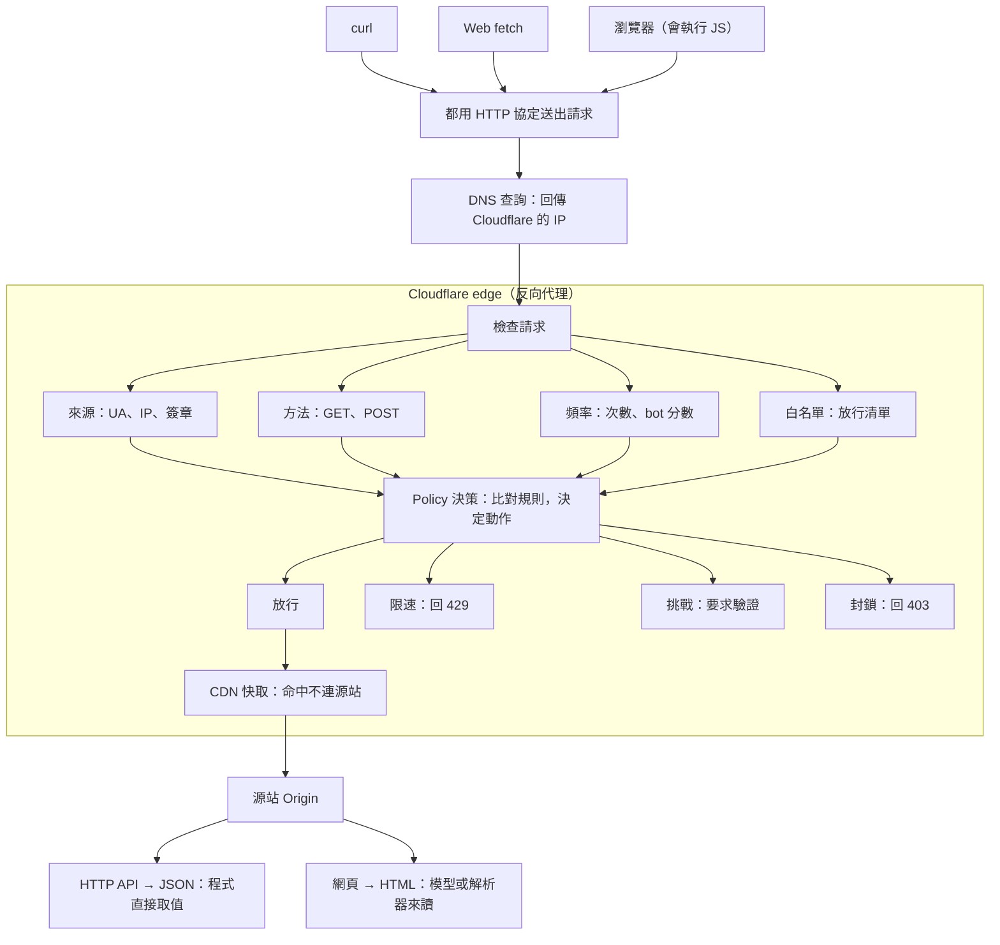

# HTTP API、網頁 HTML、curl 與 Cloudflare bot 政策

整理日期：2026-11-11。Cloudflare 產品資訊以這一天為準，之後可能改變。
來源：一次學習討論。主題是 HTTP API 與網頁 HTML 的差異、curl 與 web fetch 的關係、Cloudflare 如何處理 bot 請求。
相關文件：`claude/web-fetch-crawler-api-browser-agent-comparison.md`（agent 取得網頁的五種方法，本文件是它的前置概念）。

## 1. 一句話結論

- HTTP 是協定（規則）。curl、web fetch、瀏覽器是客戶端（送請求的程式）。
- API 和 HTML 是 server 回傳內容的形式。它們不是方法。
- 取資料的順序：先找 API。沒有 API，才讀 HTML。
- 網站常用 Cloudflare 擋 bot。請求會先被檢查，再決定放行、限速、挑戰或封鎖。

## 2. 三個層次

| 層次 | 是什麼 | 例子 |
|---|---|---|
| ① 協定 (protocol) | 雙方通訊的規則 | HTTP |
| ② 客戶端 (client) | 照規則送出請求的程式 | curl、瀏覽器、web fetch、Python `requests` |
| ③ 回傳內容的形式 | server 回來的東西 | JSON（API）、HTML（網頁） |

「HTTP API」的意思是：用 HTTP 傳輸的 API。

類比：HTTP 像郵政規則。curl 像寄信的郵差。API 的回信像填好的表格。HTML 的回信像一張海報。
不同點：同一個郵差（curl）可以寄任何一種信，請求 API 或網頁都可以。

## 3. HTTP API 與網頁 HTML 的差異

兩者都用 HTTP 向 server 要資料。差別是 server 回傳什麼。

- **HTTP API**：回傳給程式用的資料，通常是 JSON。格式固定，像一份合約。
- **網頁 HTML**：回傳給人看的頁面。裡面有導覽列、廣告、表格和文字。沒有合約。網站改版，程式或模型就可能讀錯。

### 流程比較（目標：取得 2025 年營收，數字為示例）

**HTTP API**
- Step 1：程式送出 `GET https://api.example.com/revenue?company=A&year=2025`。
- Step 2：Server 查資料庫。
- Step 3：Server 回傳 `{"revenue": 1234, "unit": "百萬"}`。
- Step 4：程式用 `data["revenue"]` 取值。單位在欄位裡。
- 誰理解資料：程式。

**Web fetch**
- Step 1：Agent 呼叫 web fetch，`url=https://example.com/investor/company-a`。
- Step 2：Server 回傳整頁 HTML。
- Step 3：工具把 HTML 轉成文字。
- Step 4：模型從文字找出「營收」。單位可能寫在表格上方，容易漏看。
- 誰理解資料：模型。

| | HTTP API | Web fetch（HTML） |
|---|---|---|
| 回傳格式 | JSON，欄位固定 | HTML，版面自由 |
| 給誰讀 | 程式 | 人，由模型代讀 |
| 穩定性 | 高，有版本與文件 | 低，改版就壞 |
| 結果可預測 | 是 | 否，模型可能讀錯 |
| 常見阻礙 | API key、流量限制 | bot challenge、cache、JS 渲染 |

### 選擇邏輯

Step 1：先找有沒有 API。有，就用 API。
Step 2：沒有 API，才讀 HTML。

網站通常對網頁加 bot challenge，對有 key 的 API 比較不擋。

### 其他可對照的例子

同一份資料常有兩條路。

| 例子 | API 路線 | HTML 路線 |
|---|---|---|
| 美國 SEC EDGAR（上市公司財報） | `data.sec.gov` 的 JSON，欄位標準化 | 申報文件的網頁 |
| 台灣證交所 | 有 OpenAPI（`openapi.twse.com.tw`），欄位要先自己確認 | 公開資訊觀測站網頁 |
| 一般公司官網 | 通常沒有 API | 只能讀 IR 頁面 HTML |

中間路線：網頁背後常是 JS 在呼叫一個 JSON API。用瀏覽器 F12 的 Network 分頁找到那個網址，就能直接打它，不必解析 HTML。

## 4. curl 與 web fetch

- **curl**：命令列工具。照 HTTP 規則送請求，把回應原樣印出來。
- **Web fetch**：Claude 的工具。照 HTTP 規則送請求，再把 HTML 轉成文字，交給模型。

| | curl | Web fetch |
|---|---|---|
| 誰用 | 人或程式 | Claude agent |
| 送出請求 | 是（HTTP） | 是（HTTP） |
| 執行 JS | 否 | 否 |
| 回傳處理 | 原樣輸出 | 轉成文字或 markdown，再給模型 |
| 下一步 | 你自己解析 | 模型自己讀 |

兩者看到的原始內容相同，都是「原始 HTML」（讀取點 ①）。Web fetch 多做了「轉文字」和「交給模型」。

### 小例子：同一個 curl，不同結果

```bash
curl -s "https://api.example.com/revenue?year=2025"
# 輸出：{"revenue": 1234, "unit": "百萬"}

curl -s "https://example.com/investor"
# 輸出：<html><head>...<script>...</script>...（整頁原始碼）
```

curl 沒有差別。差別在 URL 另一端回傳什麼。

## 5. Cloudflare 如何處理 bot 請求

### 5.1 基本角色

- **Reverse proxy（反向代理）**：站在使用者和源站之間的中介。使用者先連它，它再連源站。
- **CDN（內容傳遞網路）**：把內容快取在各地節點。命中快取就不用連源站。
- **DNS 的角色是導流。** 沒有 Cloudflare 時，DNS 回傳源站的 IP。改用 Cloudflare 代理後，DNS 回傳 Cloudflare 的 IP，請求先到 Cloudflare。它看到的來源 IP，來自連線本身。

### 5.2 判斷依據

| 依據 | 內容 |
|---|---|
| 來源 | User-Agent、IP、簽章。UA 容易偽造，所以不能只看 UA |
| 方法 | HTTP method（GET、POST）。TLS 指紋等「怎麼連線」的特徵，算在「來源」 |
| 頻率 | 請求次數、bot 分數 |
| 白名單 | 明確放行的清單 |

守規矩的 bot 會用唯一的 user-agent、公開的 IP 範圍，或 Web Bot Auth 簽章表明身分。

### 5.3 可選的動作

| 動作 | 意思 |
|---|---|
| 放行 (Allow) | 請求繼續往下走 |
| 限速 (Rate limit) | 超過次數就拒絕，預設回 429 |
| 挑戰 (Challenge) | 要求驗證（例如 JS challenge、Turnstile） |
| 封鎖 (Block) | 直接拒絕，回 403 |

動作不只開和關。AI bot 可以用 Block AI bots 一次擋掉，也可以用 WAF 自訂規則細分。

### 5.4 規則執行順序

- AI Crawl Control 的封鎖用 WAF 自訂規則。它比 Cloudflare 的 bot 規則先執行。
- Block AI bots 的優先級高於「允許已驗證 bot」。兩個都開時，已驗證的 AI bot 仍會被擋。
- Pay per crawl 在 bot 規則之後執行。所以要使用 pay per crawl，要先關掉 Block AI bots。

### 5.5 流程圖



限速、挑戰、封鎖的請求在 Cloudflare 就停下，不會到源站。

### 5.6 對 agent 的意義

- Web fetch 不會執行 JS。請求遇到「挑戰」時，它無法通過驗證，會停在那裡。
- curl 和 web fetch 走的路徑和瀏覽器相同。差別只在被判成哪一種動作。
- 命中 CDN 快取時，讀到的可能是舊內容。網站設定的快取時間越長，舊內容越久。

## 6. 容易搞混的點

- HTTP 是協定。curl 是工具。API 和 HTML 是內容形式。三者不同層。
- Web fetch 不是在打 API。它請求一般網頁網址，拿回 HTML。
- DNS 不檢查 IP。它把流量導到 Cloudflare。
- User-Agent 不能當作身分證明，因為它容易偽造。
- Cloudflare 的動作有四種，不只開和關。

## 7. 待確認

- 台灣證交所 OpenAPI 是否有要用的財報欄位。
- 目標網站實際使用的 Cloudflare 規則和快取時間。這要問網站擁有者。

## 8. 下一步可學

- HTTP 請求與回應裡有什麼：method、header、status code。
- 瀏覽器 F12 的 Network 分頁：找出網頁背後的 JSON API。
- Cloudflare 的 bot score 與 JS challenge：它如何判斷請求像不像真人。

## 來源

- Cloudflare：Bots：https://developers.cloudflare.com/bots/concepts/bot
- Cloudflare：AI Crawl Control with bots：https://developers.cloudflare.com/ai-crawl-control/configuration/ai-crawl-control-with-bots
- Cloudflare：AI Crawl Control 管理爬蟲：https://developers.cloudflare.com/ai-crawl-control/features/manage-ai-crawlers/index.md
- Cloudflare：How Cloudflare works：https://developers.cloudflare.com/learning-paths/get-started/concepts/how-cloudflare-works
- Cloudflare blog（Perplexity 與 verified bot 政策、Web Bot Auth）：https://blog.cloudflare.com/author/reid/rss
