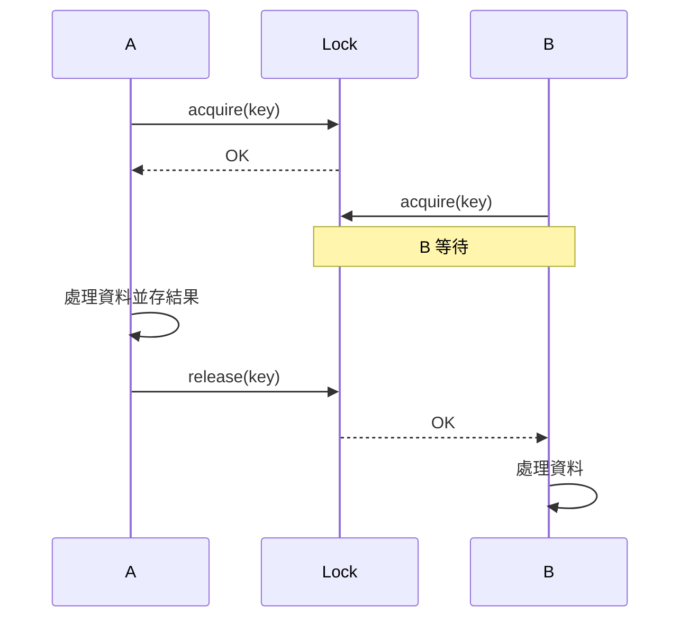
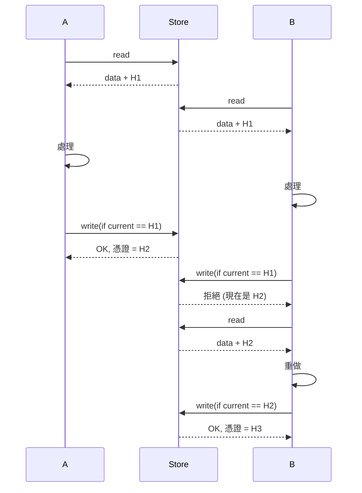

# 悲觀鎖 (Pessimistic Lock) vs 樂觀鎖 (OCC / CAS)

> 學習筆記。主題：兩個 thread / agent 要改同一份資料時，怎麼避免互相覆蓋。
> 來源：DataFrame cache 設計（key 鎖）與 Dreaming 討論（SHA256 憑證）的對照。

## 1. 一句話版本

- **悲觀鎖 (Pessimistic Lock)**：假設一定會衝突，所以先鎖再做。
- **樂觀鎖 (Optimistic Concurrency Control, OCC)**：假設衝突不常發生，所以先做，寫入時才檢查。
- 兩者的差別只有一個：衝突在哪個時間點被處理。
  - 悲觀鎖在開始前處理。B 用等待避開衝突。
  - 樂觀鎖在寫入時處理。B 用重做補救衝突。

## 2. 名詞

| 名詞 | 白話 |
|---|---|
| Pessimistic Lock（悲觀鎖） | 先搶到鎖的人才能做，其他人等。像廁所門上的「使用中」。 |
| Optimistic Concurrency Control, OCC（樂觀鎖） | 大家同時做，寫入時才檢查有沒有人先改過。 |
| Compare-And-Swap, CAS | 「如果現在還是 H1，才寫入新值。」樂觀鎖的核心動作。 |
| Version token（版本憑證） | 代表「資料現在是哪一版」的值。本例用 SHA256 hash（H1、H2、H3）。 |

類比：樂觀鎖像 Git。你 push 時發現遠端已經往前走，Git 拒絕你。你要先 pull（或 rebase）到新版本，再 push 一次。H1 就像 commit hash。
不同點：Git 重做的是「合併」，樂觀鎖預設重做的是「整個處理流程」。

## 3. 流程對照

### 悲觀鎖（先鎖，再做）

- Step 1：A 拿到鎖。key 標記為使用中。
- Step 2：B 來了，被擋住。B 排隊等待。
- Step 3：A 處理並存結果。只有 A 在做事。
- Step 4：A 放鎖。喚醒 B。
- Step 5：B 拿鎖，開始處理。用的是 A 做完的資料。
- 代價：B 全程在等。

### 樂觀鎖（先做，寫入時才檢查）

- Step 1：A、B 都讀到 H1。H1 是起點版本憑證。
- Step 2：A、B 同時處理。沒有人等待。
- Step 3：A 先寫入。H1 還是現在的版本，所以存入。憑證變 H2。
- Step 4：B 寫入。B 手上是 H1，但現在是 H2。系統拒絕寫入。
- Step 5：B 讀 H2，從 H2 重做。寫入成功。憑證變 H3。
- 代價：B 的工作白做一次。

## 4. 其他方法

- **Lease Lock（有期限的鎖）**：悲觀鎖加過期時間。A 掛掉時，鎖自己失效，B 不會永遠卡住。
- **Read-Write Lock（讀寫鎖）**：很多人可以同時讀。寫的時候只能一個人。
- **Single Writer Queue（單一寫入者）**：所有寫入請求排成一條隊，由一個 worker 依序處理。沒有衝突，也不用鎖。
- **Merge（合併）**：B 發現過期時，不整個重做，而是把 A 和 B 的改動合併。像 Git 的 three-way merge。

## 5. 怎麼選

| 情況 | 建議 |
|---|---|
| 衝突很少、重做很便宜 | 樂觀鎖 (OCC) |
| 衝突很多 | 悲觀鎖，或 Single Writer Queue |
| 重做很貴（例如一次 LLM 呼叫要花錢） | 悲觀鎖，或 Single Writer Queue |
| 持有鎖的人可能中途掛掉 | 悲觀鎖要加 Lease（過期時間） |
| 讀多寫少 | Read-Write Lock，或樂觀鎖 |

## 6. 下一步

學 CAS 在資料庫裡的實際寫法（`UPDATE ... WHERE version = ?`），以及寫入失敗時怎麼自動重試。
