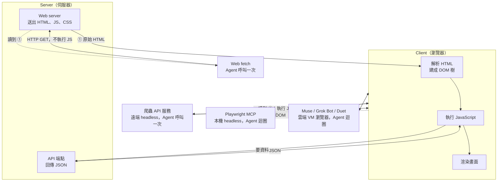

# Web fetch、爬蟲 API 與 Browser Agent：Agent 怎麼取得網頁內容

整理日期：2026-11-11。產品資訊以這一天為準，之後可能改變。
來源：一次討論，主題是 agent 如何讀網頁、web fetch、爬蟲 API 服務、瀏覽器 agent。

## 1. 一句話結論

Agent 取得網頁有四種方法。
差別只有兩個：「讀到哪個時間點的 HTML」和「瀏覽器在哪裡」。

選擇順序：
1. 有官方 API，先用官方 API。
2. 靜態頁面，用 web fetch。
3. 靠 JS 渲染、流程固定，用爬蟲 API 服務或自己的 headless browser。
4. 需要判斷、點擊、多步操作，用 browser agent。

## 2. 基本概念

- **Server**：存放並送出網頁的電腦。
- **Browser**：使用者端的程式，負責載入並顯示網頁。
- **HTML**：網頁的文字內容與結構。它是一個文字檔。
- **JavaScript (JS)**：在瀏覽器裡執行的程式。它可以改變網頁。
- **DOM (Document Object Model)**：瀏覽器把 HTML 變成的樹狀結構。它像一張家譜圖。不同點：JS 會即時改寫 DOM，原本的 HTML 檔不會變。
- **API**：Server 給程式用的資料入口，通常回傳 JSON。
- **Headless browser**：沒有畫面的瀏覽器。它像一台沒有螢幕的電腦。程式照樣能載入頁面、執行 JS。

### 網頁怎麼產生

Step 1：Browser 向 Server 要一個網址。
Step 2：Server 回傳 HTML。**這是讀取點 ① 原始 HTML。**
Step 3：Browser 把 HTML 解析成 DOM。
Step 4：Browser 執行 JS。JS 常會呼叫 API 要 JSON，再改寫 DOM。
Step 5：Browser 畫出畫面。**這是讀取點 ② 執行 JS 後的 DOM。**

| 讀取點 | 在瀏覽器裡怎麼看 | 誰讀這裡 |
|---|---|---|
| ① 原始 HTML | 右鍵「檢視網頁原始碼」 | web fetch |
| ② 執行 JS 後的 DOM | F12 的 Elements 分頁 | 所有用瀏覽器的方法 |

### 小例子：商品頁

- ① 原始 HTML：`<div id="app"></div>`。內容是空的。
- ② 執行 JS 後的 DOM：`<div id="app"><h1>耳機</h1><span>NT$1,200</span></div>`。內容已經長出來。
- Web fetch 只看到空的 div。瀏覽器看到商品名稱和價格。

判斷方法：右鍵「檢視原始碼」，要的資料在裡面，web fetch 就夠。不在，就需要能執行 JS 的瀏覽器。

## 3. 流程圖

圖中紫色方是 agent 側，這裡用文字版和 Mermaid 呈現。

### 文字版

- Web fetch：Agent → HTTP GET → Server → 讀到 ①。Agent 呼叫一次。
- 爬蟲 API 服務：Agent → 服務（遠端 headless 瀏覽器）→ Server → 讀到 ②。Agent 呼叫一次。
- Playwright MCP：Agent ↻ 本機 headless 瀏覽器 → Server → 讀到 ②。Agent 迴圈操作。
- Muse / Grok Bot / Duet：Agent ↻ 雲端 VM 裡的瀏覽器 → Server → 讀到 ②。Agent 迴圈操作。

### Mermaid



## 4. 五種方法比較

| 方法 | 瀏覽器在哪 | Agent 的執行方式 | 讀到 | 適合 |
|---|---|---|---|---|
| Web fetch | 沒有瀏覽器 | 呼叫一次工具 | ① | 靜態頁面、PDF |
| 爬蟲 API 服務（如 Firecrawl、ScrapingBee、Jina Reader） | 服務商的遠端 headless | 呼叫一次，服務代為渲染並轉 markdown | ② | 大量、固定格式的抓取 |
| Playwright MCP、Chrome DevTools MCP | 你的機器上的 headless | 迴圈：快照 → 決定 → 動作 → 再快照 | ② | 自動化、測試、需要判斷的操作 |
| Muse、Grok Bot、Claude Duet | 廠商雲端 VM | 迴圈，agent 與瀏覽器都在 VM 裡 | ② | 個人事務、通用任務 |
| Claude in Chrome | 你自己的 Chrome（有畫面） | 迴圈，沿用你的登入狀態 | ② | 要用你已登入的網站 |

### 容易搞混的三點

- **Web fetch 不是在打 API。** 它請求的是一般網頁網址，拿回 HTML。API 的網址回傳的是 JSON。
- **Web search 不是在讀 HTML。** 它查搜尋引擎的索引，回傳網址和摘要，用來「找到」該看哪一頁。
- **瀏覽器 agent 看的是頁面（DOM），不會直接打網站的 API。** 頁面背後常常是 JS 在打 API，agent 只看到畫好的結果。

## 5. Browser agent 怎麼運作

### 5.1 快照 (snapshot)

快照把網頁轉成模型能讀的格式。有兩種：

| 種類 | 內容 | 需要的模型 |
|---|---|---|
| 畫面截圖 | 一張圖片 | 要有視覺能力 |
| DOM／無障礙樹快照 (accessibility tree snapshot) | 文字清單，只留可互動元素，每個編號 | 純文字模型就行 |

不直接餵原始 DOM。原因：它常有幾十萬 token，而且雜訊多。

### 5.2 操作迴圈（小例子：登入）

Step 1：Extension 讀 DOM，產生快照。

```
[1] textbox "帳號"
[2] textbox "密碼"
[3] button "送出"
```

Step 2：模型回答「在 [1] 輸入 alice」。
Step 3：Extension 用 JS 操作 DOM：

```js
document.querySelector("#user").value = "alice";
```

Step 4：等頁面穩定，再取新快照。編號會重新計算。重複到任務完成。

### 5.3 自建架構（Chrome extension + 地端模型）

```
網頁 ↔ content script（讀 DOM、執行動作）
     ↔ extension 背景程式 (service worker)
     ↔ WebSocket 或 Native Messaging
     ↔ Agent 服務（workflow 邏輯）
     ↔ OpenAI 相容 API
     ↔ 地端模型（vLLM、Ollama 等）
```

- 把 extension 的能力包成工具：`get_snapshot()`、`click(ref)`、`type(ref, text)`、`navigate(url)`。
- 接法有兩種：WebSocket，或包成 MCP server。
- Agent 服務每一步把模型的 tool call 轉給 extension，再把新快照回給模型。

**優點：** 頁面資料不離開公司。沿用使用者已登入的 session。
**代價：** 地端模型的 tool calling 和長 context 通常較弱。快照吃 token。每一步都要呼叫一次模型，所以慢。

**主要問題：**
1. Prompt injection：網頁文字是不可信輸入。頁面可以藏一句惡意指令。
2. 權限過大：extension 用你的登入狀態，agent 做的事等同你本人做的。
3. 快照不完整：canvas、iframe、shadow DOM 讀不到。動態載入的頁面可能抓到舊內容。
4. 元素編號會過期。可能陷入無限迴圈。
5. Chrome MV3 的 service worker 會休眠，長連線要處理。

### 5.4 捲動載入與巢狀結構

- 快照只是某一瞬間。頁面一變，舊編號就失效。
- 捲動載入：捲動 → 等 DOM 穩定（例如 `MutationObserver` 一段時間沒有變動）→ 重新快照 → 比對有沒有新元素。沒有新元素就是到底。要設步數上限。
- 無限捲動背後常是分頁（例如 `?page=2`）。找到規律就可以直接用 web fetch 一頁一頁抓。
- 巢狀結構：展開式選單由 agent 點展開、再快照。iframe 要注入每個 frame，編號要帶 frame id。Shadow DOM 要遞迴走進 shadowRoot。要設深度上限。
- **分工原則：** 重複又固定的動作，寫成 extension 的複合工具，例如 `scroll_to_bottom()`、`expand_all()`。模型只做判斷。這樣更快、更省 token、更穩。

## 6. Claude API 與 Claude Code 的相關工具

### Claude API

| 工具 | 運作方式 | 備註 |
|---|---|---|
| Web fetch tool | 伺服器工具 (server tool)。API 在請求期間代你抓內容，支援 PDF | 文件註明不支援靠 JS 動態渲染的網站。可用 `allowed_domains` 限制網域。文件警告：不可信輸入加上敏感資料，有資料外洩風險 |
| Browser use tool | 客戶端工具集 (client toolset)，型別 `browser_toolset_20260801`。瀏覽器環境由你提供並執行 | 在 Claude API 為正式版。文件列出 Google Cloud 可用，Azure 是否支援要另外確認 |
| Computer use tool | 用整個桌面的截圖與座標操作 | 任務只在網頁內時，官方建議用 browser use |

官方建議：只是讀你給的網址，web fetch 比較輕量。任務是操作網頁，或頁面用 JS 建構內容，用 browser use。

### Claude Code 使用 headless 瀏覽器

Claude in Chrome 不是 headless。要 headless，用 MCP 伺服器：

```bash
claude mcp add playwright -- npx @playwright/mcp@latest --headless --isolated
claude mcp add chrome-devtools -- npx chrome-devtools-mcp@latest --headless=true --isolated=true
```

裝完要重啟 Claude Code，再用 `claude mcp list` 確認狀態是 Connected。沒有螢幕的伺服器環境一定要用 headless。

| | Playwright MCP | Chrome DevTools MCP | Claude in Chrome |
|---|---|---|---|
| Headless | 可以 | 可以 | 不行 |
| 瀏覽器 | Chrome、Firefox、Safari | 只有 Chrome | 只有 Chrome |
| 登入狀態 | 要另外處理 | 要另外處理 | 沿用你的 |
| 適合 | 自動化、CI/CD | 除錯、效能、網路 | 快速目視檢查、已登入網站 |

### Claude in Chrome

- Chrome 擴充功能，目前是 beta。Claude 在側邊欄讀取、點擊、操作網站。
- 付費方案可用（Pro、Max、Team、Enterprise）。只支援 Google Chrome，不支援其他 Chromium 瀏覽器或手機。
- Team 和 Enterprise 由管理員控制開關與網站白名單、黑名單。
- 它是擴充功能，不在 claude.ai 網頁裡。方向是「Chrome 裡面裝 Claude」。

### 雲端 agent 產品

| 產品 | 發布 | 特點 |
|---|---|---|
| Muse (Meta) | 2026-09-08 | 專屬雲端 VM，有自己的瀏覽器。關掉 app 後仍繼續工作 |
| Grok Bot (xAI) | 2026-08-11 | 持久的雲端電腦：瀏覽器、檔案系統、終端機。購物時每筆扣款要人工核准 |
| Claude Duet (Anthropic) | 2026-10-21 | 研究預覽。雲端 VM 與瀏覽器。發訊息、付款、簽文件、刪除前要核准 |

Claude Duet 的使用條件：Pro 或 Max 方案、美國的 Claude 帳號、候補名單邀請。Team 與 Enterprise 目前不符合。

這三個產品的共同點：瀏覽器在廠商雲端，頁面資料會送到廠商。它們也都是「有連接器或 API 就先用，沒有才用瀏覽器」。

## 7. HTML 轉 markdown，減少 token

- 原始 HTML 大部分是 `<script>`、`<style>`、導覽列、廣告。模型用不到。
- Web fetch 工具和 browser use 的 `read_page` 已經處理過，不用自己轉。
- 自己抓 HTML 時：先移除 `script`、`style`、`nav`、`footer`，再抽出主要內容（`trafilatura`、`readability`），最後轉 markdown（`turndown`、`html2text`）。
- **財報的表格要特別處理。** 合併儲存格和多層表頭，轉成 markdown 後可能錯位。單位（千元、百萬）常寫在表格上方，容易被濾掉。
- 做法：文字轉 markdown。表格用 `pandas.read_html` 解析成資料表，再轉成 CSV 或 JSON 給模型。
- 抽出數字後用程式驗算（例如各項加總是否對得上）。不要只信模型。

## 8. 風險與邊界

- **瀏覽器不是「繞過反爬」。** 它只是比較像真人的存取方式。CAPTCHA、Cloudflare 挑戰、IP 信譽、行為偵測、流量限制，瀏覽器都解決不了。Claude 遇到登入頁或 CAPTCHA 時會暫停，這是人工控制的邊界。
- 網站擋爬蟲通常是刻意的。硬繞可能違反服務條款。偽裝指紋、破解 CAPTCHA 這類規避措施不採用。
- 使用爬蟲 API 服務不代表可以無視網站規則。
- 合理做法：先找官方 API、RSS、資料授權。有權限的內容用自己登入的瀏覽器讀。控制頻率，遵守 `robots.txt`。重要資料來源，直接聯絡對方申請存取。
- Prompt injection：網頁內容是不可信輸入。限制網域白名單。避免讓同一個 agent 同時接觸網頁和內部機密資料。
- 高風險動作（送出、刪除、付款）要人工確認。要設步數上限。
- 資料去向：Claude API 與雲端 agent 產品會把頁面資料送到廠商。內部資料要先確認公司的資料政策。
- 能固定的流程寫成固定 workflow。只有需要判斷的步驟交給 LLM。

## 9. 選擇指南

Step 1：有官方 API 嗎？有，就用官方 API。
Step 2：要的資料在「檢視原始碼」裡嗎？在，用 web fetch。
Step 3：資料靠 JS 載入，但找得到背後的網址或分頁規律？用 web fetch 直接打那個網址。
Step 4：找不到規律，流程固定、量大？用爬蟲 API 服務或自己的 headless browser。
Step 5：需要判斷、點擊、多步操作？用 browser agent。
Step 6：需要你已登入的網站？用 Claude in Chrome。

## 10. 待確認

- Azure 上是否支援 Claude 的 browser use tool。
- 公司對「頁面資料送到雲端模型」的政策。
- 目標網站的服務條款與 `robots.txt`。

## 來源

- Web fetch tool：https://platform.claude.com/docs/en/agents-and-tools/tool-use/web-fetch-tool
- Browser use tool：https://platform.claude.com/docs/en/agents-and-tools/tool-use/browser-use-tool
- Claude in Chrome：https://support.claude.com/en/articles/12012173-claude-in-chrome
- Claude Duet：https://support.claude.com/en/articles/17631495-getting-started-with-claude-duet
- Meta Muse 發布報導：https://www.vktr.com/ai-platforms/meta-launches-muse-a-personal-ai-agent-that-browses-the-web-makes-purchases/
- Grok Bot 說明：https://aiidelist.com/blog/grok-bot.md
- Claude Code 的瀏覽器工具比較：https://bug0.com/blog/claude-code-playwright-mcp
- Headless Chrome 與 DevTools MCP：https://mikesvoboda.github.io/nemotron-v3-home-security-intelligence/developer/contributing/chrome-devtools
